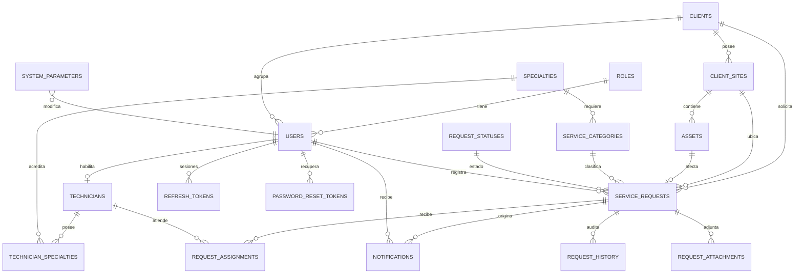
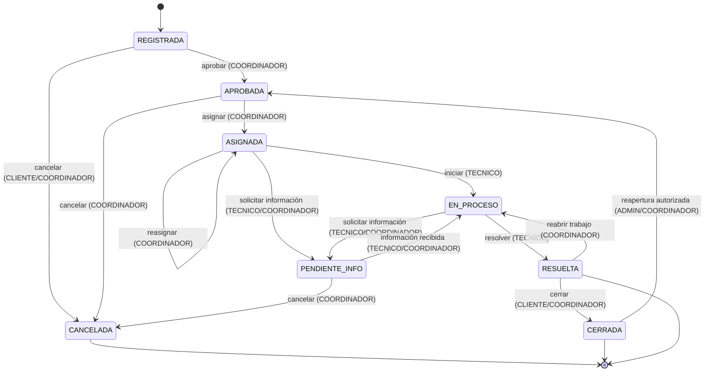

# 02 — Modelo de dominio y datos

**Motor:** PostgreSQL 16 · **ORM:** Prisma · **Convención:** tablas y columnas en `snake_case`, API en `camelCase`.

## 1. Lenguaje ubicuo

| Término | Definición | Entidad |
| :--- | :--- | :--- |
| Usuario | Persona que inicia sesión; tiene un rol y estado. | `users` |
| Rol | Perfil de autorización: ADMIN, COORDINADOR, TECNICO, CLIENTE. | `roles` |
| Cliente | Organización que contrata servicios. | `clients` |
| Sede | Ubicación del cliente donde se atiende. | `client_sites` |
| Equipo | Recurso físico afectado o atendido en una sede. | `assets` |
| Técnico | Usuario habilitado para ejecutar servicios. | `technicians` |
| Especialidad | Competencia técnica requerida por una categoría. | `specialties` |
| Categoría | Tipo de servicio solicitado. | `service_categories` |
| Solicitud | Caso de servicio con ciclo de vida y SLA. | `service_requests` |
| Asignación | Vínculo vigente entre solicitud y técnico. | `request_assignments` |
| Historial | Bitácora inmutable de eventos de la solicitud. | `request_history` |
| Adjunto | Archivo asociado a una solicitud. | `request_attachments` |
| Notificación | Aviso dirigido a un usuario. | `notifications` |
| Parámetro | Configuración operativa editable (SLA, cargas). | `system_parameters` |

## 2. Diagrama entidad-relación



## 3. Diccionario de entidades

### 3.1. `roles`

| Columna | Tipo | Restricciones |
| :--- | :--- | :--- |
| `id` | `SMALLINT` | PK |
| `code` | `VARCHAR(20)` | UNIQUE, NOT NULL |
| `name` | `VARCHAR(60)` | NOT NULL |

Datos: `ADMIN`, `COORDINADOR`, `TECNICO`, `CLIENTE`.

### 3.2. `users`

| Columna | Tipo | Restricciones |
| :--- | :--- | :--- |
| `id` | `UUID` | PK, default `gen_random_uuid()` |
| `email` | `CITEXT` | UNIQUE, NOT NULL |
| `password_hash` | `TEXT` | NOT NULL, nunca expuesto |
| `full_name` | `VARCHAR(120)` | NOT NULL |
| `phone` | `VARCHAR(20)` | NULL |
| `role_id` | `SMALLINT` | FK `roles`, NOT NULL |
| `client_id` | `UUID` | FK `clients`, NULL (solo CLIENTE) |
| `status` | `VARCHAR(15)` | `ACTIVO`/`INACTIVO`, NOT NULL |
| `must_change_password` | `BOOLEAN` | default `false` |
| `failed_attempts` | `SMALLINT` | default `0` |
| `locked_until` | `TIMESTAMPTZ` | NULL |
| `last_login_at` | `TIMESTAMPTZ` | NULL |
| `created_at` | `TIMESTAMPTZ` | NOT NULL, default `now()` |
| `updated_at` | `TIMESTAMPTZ` | NOT NULL, default `now()` |

Índices: `(role_id)`, `(client_id)`, `(status)`. Restricción: si `role_id = CLIENTE` entonces `client_id` no nulo (validación en servicio + check).

### 3.3. `clients`

| Columna | Tipo | Restricciones |
| :--- | :--- | :--- |
| `id` | `UUID` | PK |
| `ruc` | `VARCHAR(13)` | UNIQUE, NOT NULL |
| `business_name` | `VARCHAR(160)` | NOT NULL |
| `trade_name` | `VARCHAR(160)` | NULL |
| `email` | `CITEXT` | NOT NULL |
| `phone` | `VARCHAR(20)` | NULL |
| `address` | `TEXT` | NULL |
| `status` | `VARCHAR(15)` | `ACTIVO`/`INACTIVO` |
| `created_at` / `updated_at` | `TIMESTAMPTZ` | NOT NULL |

### 3.4. `client_sites`

| Columna | Tipo | Restricciones |
| :--- | :--- | :--- |
| `id` | `UUID` | PK |
| `client_id` | `UUID` | FK `clients` `ON DELETE RESTRICT` |
| `name` | `VARCHAR(120)` | NOT NULL |
| `address` | `TEXT` | NOT NULL |
| `city` | `VARCHAR(80)` | default `Guayaquil` |
| `contact_name` | `VARCHAR(120)` | NULL |
| `contact_phone` | `VARCHAR(20)` | NULL |
| `status` | `VARCHAR(15)` | `ACTIVA`/`INACTIVA` |

Índice único: `(client_id, name)`.

### 3.5. `assets`

| Columna | Tipo | Restricciones |
| :--- | :--- | :--- |
| `id` | `UUID` | PK |
| `site_id` | `UUID` | FK `client_sites` `ON DELETE RESTRICT` |
| `code` | `VARCHAR(40)` | UNIQUE por sede |
| `name` | `VARCHAR(120)` | NOT NULL |
| `asset_type` | `VARCHAR(60)` | NULL |
| `serial_number` | `VARCHAR(80)` | NULL |
| `status` | `VARCHAR(20)` | `OPERATIVO`/`FUERA_SERVICIO` |

### 3.6. `technicians`

| Columna | Tipo | Restricciones |
| :--- | :--- | :--- |
| `id` | `UUID` | PK |
| `user_id` | `UUID` | FK `users`, UNIQUE |
| `employee_code` | `VARCHAR(20)` | UNIQUE |
| `availability` | `VARCHAR(20)` | `DISPONIBLE`/`NO_DISPONIBLE` |
| `max_concurrent_load` | `SMALLINT` | default 5, CHECK > 0 |
| `created_at` / `updated_at` | `TIMESTAMPTZ` | NOT NULL |

### 3.7. `specialties`

| Columna | Tipo | Restricciones |
| :--- | :--- | :--- |
| `id` | `SMALLINT` | PK (serial) |
| `code` | `VARCHAR(30)` | UNIQUE |
| `name` | `VARCHAR(100)` | UNIQUE |
| `description` | `TEXT` | NULL |
| `status` | `VARCHAR(15)` | `ACTIVA`/`INACTIVA` |

### 3.8. `technician_specialties`

| Columna | Tipo | Restricciones |
| :--- | :--- | :--- |
| `technician_id` | `UUID` | FK `technicians` |
| `specialty_id` | `SMALLINT` | FK `specialties` |
| `level` | `VARCHAR(15)` | `BASICO`/`INTERMEDIO`/`AVANZADO` |

PK compuesta `(technician_id, specialty_id)`.

### 3.9. `service_categories`

| Columna | Tipo | Restricciones |
| :--- | :--- | :--- |
| `id` | `SMALLINT` | PK |
| `code` | `VARCHAR(30)` | UNIQUE |
| `name` | `VARCHAR(120)` | NOT NULL |
| `specialty_id` | `SMALLINT` | FK `specialties` |
| `default_priority` | `VARCHAR(10)` | `CRITICA`/`ALTA`/`MEDIA`/`BAJA` |
| `status` | `VARCHAR(15)` | `ACTIVA`/`INACTIVA` |

### 3.10. `request_statuses`

| Columna | Tipo | Restricciones |
| :--- | :--- | :--- |
| `id` | `SMALLINT` | PK |
| `code` | `VARCHAR(20)` | UNIQUE |
| `name` | `VARCHAR(60)` | NOT NULL |
| `is_terminal` | `BOOLEAN` | default `false` |
| `sort_order` | `SMALLINT` | NOT NULL |

### 3.11. `service_requests`

| Columna | Tipo | Restricciones |
| :--- | :--- | :--- |
| `id` | `UUID` | PK |
| `code` | `VARCHAR(20)` | UNIQUE, NOT NULL, inmutable |
| `client_id` | `UUID` | FK `clients` `ON DELETE RESTRICT` |
| `site_id` | `UUID` | FK `client_sites` `ON DELETE RESTRICT` |
| `asset_id` | `UUID` | FK `assets` `ON DELETE SET NULL`, NULL |
| `category_id` | `SMALLINT` | FK `service_categories` |
| `priority` | `VARCHAR(10)` | NOT NULL |
| `status_id` | `SMALLINT` | FK `request_statuses` |
| `description` | `TEXT` | NOT NULL, 20–2000 chars |
| `resolution` | `TEXT` | NULL, ≥ 30 chars al resolver |
| `cancellation_reason` | `TEXT` | NULL |
| `created_by` | `UUID` | FK `users` |
| `assigned_technician_id` | `UUID` | FK `technicians`, NULL (desnormalización de la asignación vigente) |
| `due_at` | `TIMESTAMPTZ` | NOT NULL, calculado |
| `sla_paused_minutes` | `INTEGER` | default 0 |
| `paused_at` | `TIMESTAMPTZ` | NULL |
| `approved_at` | `TIMESTAMPTZ` | NULL |
| `assigned_at` | `TIMESTAMPTZ` | NULL |
| `started_at` | `TIMESTAMPTZ` | NULL |
| `resolved_at` | `TIMESTAMPTZ` | NULL |
| `closed_at` | `TIMESTAMPTZ` | NULL |
| `version` | `INTEGER` | default 1, bloqueo optimista |
| `created_at` / `updated_at` | `TIMESTAMPTZ` | NOT NULL |

Índices: `(status_id)`, `(priority)`, `(client_id, created_at DESC)`, `(assigned_technician_id, status_id)`, `(due_at)`, `(created_at)`.

### 3.12. `request_assignments`

| Columna | Tipo | Restricciones |
| :--- | :--- | :--- |
| `id` | `UUID` | PK |
| `request_id` | `UUID` | FK `service_requests` `ON DELETE RESTRICT` |
| `technician_id` | `UUID` | FK `technicians` |
| `assigned_by` | `UUID` | FK `users` |
| `reason` | `TEXT` | NULL en asignación inicial; obligatorio ≥ 10 en reasignación |
| `status` | `VARCHAR(15)` | `VIGENTE`/`FINALIZADA` |
| `assigned_at` | `TIMESTAMPTZ` | NOT NULL |
| `ended_at` | `TIMESTAMPTZ` | NULL |

Índice parcial único: `UNIQUE (request_id) WHERE status = 'VIGENTE'`.

### 3.13. `request_history` (append-only)

| Columna | Tipo | Restricciones |
| :--- | :--- | :--- |
| `id` | `BIGSERIAL` | PK |
| `request_id` | `UUID` | FK `service_requests` `ON DELETE RESTRICT` |
| `actor_id` | `UUID` | FK `users`, NULL para eventos del sistema |
| `action` | `VARCHAR(30)` | `CREACION`, `TRANSICION`, `ASIGNACION`, `REASIGNACION`, `REAPERTURA`, `EDICION`, `ADJUNTO` |
| `from_status` | `VARCHAR(20)` | NULL |
| `to_status` | `VARCHAR(20)` | NULL |
| `comment` | `TEXT` | NULL |
| `metadata` | `JSONB` | NULL (técnico anterior/nuevo, campos modificados) |
| `created_at` | `TIMESTAMPTZ` | NOT NULL, default `now()` |

Índice: `(request_id, created_at)`. Sin `UPDATE`/`DELETE` a nivel de aplicación; opcional trigger que los bloquee.

### 3.14. `request_attachments`

| Columna | Tipo | Restricciones |
| :--- | :--- | :--- |
| `id` | `UUID` | PK |
| `request_id` | `UUID` | FK `service_requests` |
| `uploaded_by` | `UUID` | FK `users` |
| `file_name` | `VARCHAR(255)` | NOT NULL |
| `mime_type` | `VARCHAR(100)` | NOT NULL |
| `size_bytes` | `INTEGER` | CHECK ≤ 10 485 760 |
| `storage_key` | `TEXT` | UNIQUE, NOT NULL |
| `created_at` | `TIMESTAMPTZ` | NOT NULL |

Tipos permitidos: `application/pdf`, `image/png`, `image/jpeg`, `image/webp`.

### 3.15. `notifications`

| Columna | Tipo | Restricciones |
| :--- | :--- | :--- |
| `id` | `UUID` | PK |
| `user_id` | `UUID` | FK `users` |
| `request_id` | `UUID` | FK `service_requests`, NULL |
| `type` | `VARCHAR(40)` | `SOLICITUD_REGISTRADA`, `ASIGNACION`, `CAMBIO_ESTADO`, `INFO_REQUERIDA`, `CIERRE`, `REAPERTURA` |
| `title` | `VARCHAR(160)` | NOT NULL |
| `body` | `TEXT` | NOT NULL |
| `read_at` | `TIMESTAMPTZ` | NULL |
| `created_at` | `TIMESTAMPTZ` | NOT NULL |

Índice: `(user_id, read_at, created_at DESC)`.

### 3.16. `refresh_tokens`

| Columna | Tipo | Restricciones |
| :--- | :--- | :--- |
| `id` | `UUID` | PK |
| `user_id` | `UUID` | FK `users` `ON DELETE CASCADE` |
| `token_hash` | `TEXT` | UNIQUE, NOT NULL |
| `expires_at` | `TIMESTAMPTZ` | NOT NULL |
| `revoked_at` | `TIMESTAMPTZ` | NULL |
| `created_at` | `TIMESTAMPTZ` | NOT NULL |

### 3.17. `password_reset_tokens`

| Columna | Tipo | Restricciones |
| :--- | :--- | :--- |
| `id` | `UUID` | PK |
| `user_id` | `UUID` | FK `users` `ON DELETE CASCADE` |
| `token_hash` | `TEXT` | UNIQUE |
| `expires_at` | `TIMESTAMPTZ` | NOT NULL (30 min) |
| `used_at` | `TIMESTAMPTZ` | NULL |

### 3.18. `system_parameters`

| Columna | Tipo | Restricciones |
| :--- | :--- | :--- |
| `key` | `VARCHAR(60)` | PK |
| `value` | `JSONB` | NOT NULL |
| `description` | `TEXT` | NULL |
| `updated_by` | `UUID` | FK `users` |
| `updated_at` | `TIMESTAMPTZ` | NOT NULL |

Claves iniciales: `sla.critica.hours=4`, `sla.alta.hours=8`, `sla.media.hours=24`, `sla.baja.hours=72`, `work.calendar.start=08:00`, `work.calendar.end=17:00`, `technician.default.max_load=5`.

### 3.19. `holidays`

| Columna | Tipo | Restricciones |
| :--- | :--- | :--- |
| `date` | `DATE` | PK |
| `name` | `VARCHAR(120)` | NOT NULL |

## 4. Máquina de estados



### 4.1. Matriz de transiciones

| Desde | Hacia | Acción | Roles | Condiciones obligatorias |
| :--- | :--- | :--- | :--- | :--- |
| `REGISTRADA` | `APROBADA` | `aprobar` | ADMIN, COORDINADOR | — |
| `REGISTRADA` | `CANCELADA` | `cancelar` | CLIENTE (propia), COORDINADOR | `motivo` ≥ 10 |
| `APROBADA` | `ASIGNADA` | `asignar` | COORDINADOR | Técnico válido (RN-05) |
| `APROBADA` | `CANCELADA` | `cancelar` | COORDINADOR | `motivo` ≥ 10 |
| `ASIGNADA` | `EN_PROCESO` | `iniciar` | TECNICO asignado | Asignación vigente |
| `ASIGNADA` | `PENDIENTE_INFO` | `solicitar_info` | TECNICO asignado, COORDINADOR | `comentario` ≥ 10 |
| `ASIGNADA` | `ASIGNADA` | `reasignar` | COORDINADOR | Técnico válido + `motivo` ≥ 10 |
| `EN_PROCESO` | `PENDIENTE_INFO` | `solicitar_info` | TECNICO asignado, COORDINADOR | `comentario` ≥ 10 |
| `EN_PROCESO` | `RESUELTA` | `resolver` | TECNICO asignado | `resolucion` ≥ 30 |
| `PENDIENTE_INFO` | `EN_PROCESO` | `reanudar` | TECNICO asignado, COORDINADOR | — |
| `PENDIENTE_INFO` | `CANCELADA` | `cancelar` | COORDINADOR | `motivo` ≥ 10 |
| `RESUELTA` | `CERRADA` | `cerrar` | CLIENTE (propia), COORDINADOR | `resolucion` existente (RN-01) |
| `RESUELTA` | `EN_PROCESO` | `reabrir_trabajo` | COORDINADOR | `motivo` ≥ 10 |
| `CERRADA` | `APROBADA` | `reapertura` | ADMIN, COORDINADOR | `motivo` ≥ 20; auditoría `REAPERTURA` |
| `CANCELADA` | — | — | — | Terminal, sin transiciones |

**Reglas transversales:**

- Cualquier transición no listada → `409 TRANSICION_INVALIDA`.
- `CERRADA` solo sale por `reapertura`; cualquier otro intento → `409 SOLICITUD_CERRADA`.
- Cada transición actualiza los timestamps correspondientes y `version`.
- La transición y el registro de historial ocurren en **una sola transacción**.
- Las notificaciones se encolan dentro de la transacción y se publican después del commit (patrón outbox simple en memoria + SSE).

## 5. Algoritmo de SLA

```
dueAt = addBusinessHours(
  createdAt,
  slaHours(priority),
  pauseMinutes = slaPausedMinutes
)

addBusinessHours(start, hours, pauseMinutes):
  cursor = start
  remaining = hours + (pauseMinutes / 60)
  while remaining > 0:
    cursor = nextBusinessMoment(cursor)   # avanza a 08:00 del siguiente día hábil si está fuera de horario o es feriado
    available = minutesUntilClosing(cursor) / 60
    consume = min(remaining, available)
    remaining -= consume
    cursor += consume horas
  return cursor
```

- `nextBusinessMoment` salta fines de semana y feriados (`holidays`).
- Al pasar a `PENDIENTE_INFO`: `paused_at = now()`.
- Al reanudar: `sla_paused_minutes += minutesBetween(paused_at, now())`; `paused_at = null`; se recalcula `due_at`.
- Cambio de prioridad: se recalcula `due_at` desde `created_at` con la nueva prioridad y las pausas acumuladas.
- `isOverdue = now > due_at AND status NOT IN (RESUELTA, CERRADA, CANCELADA)`.
- Zona horaria fija `America/Guayaquil` en el cálculo.

## 6. Invariantes del dominio

| ID | Invariante | Verificación |
| :--- | :--- | :--- |
| INV-01 | `service_requests.code` único e inmutable. | `UNIQUE` + servicio sin actualización. |
| INV-02 | Una sola asignación `VIGENTE` por solicitud. | Índice parcial único + transacción. |
| INV-03 | `RESUELTA`/`CERRADA` ⇒ `resolution` no nulo. | Validación de servicio + prueba. |
| INV-04 | `closed_at` no nulo ⇔ estado `CERRADA`. | Servicio transaccional. |
| INV-05 | `request_history` solo inserta. | Sin endpoints de escritura; trigger opcional. |
| INV-06 | `due_at` siempre calculado en servidor. | Campo no aceptado desde el cliente. |
| INV-07 | Un técnico activo tiene al menos una especialidad. | Validación al crear/editar. |
| INV-08 | Un usuario `CLIENTE` siempre tiene `client_id`. | Check + validación. |
| INV-09 | `email` único sin distinguir mayúsculas. | `CITEXT`/`LOWER()` unique. |
| INV-10 | El adjunto pertenece a una solicitud existente y accesible. | FK + autorización. |

## 7. Estrategia de migraciones y seed

- Migraciones con `prisma migrate dev --name <descripcion>` en desarrollo.
- Producción: `prisma migrate deploy` (nunca `db push`).
- Seed idempotente (`prisma db seed`) con:
  - 4 roles, 4 estados base y parámetros por defecto.
  - 4 usuarios (uno por rol) con contraseña `ServiGest2026*` (solo desarrollo).
  - 3 clientes, 5 sedes, 8 equipos, 4 técnicos, 6 especialidades y 8 categorías.
  - 60 solicitudes distribuidas en estados y fechas para alimentar el dashboard.
  - Notificaciones e historial coherentes con las solicitudes.
- Datos de prueba documentados en `08-despliegue.md § 6`.

## 8. Retención y protección de datos

- No se almacenan datos sensibles innecesarios (tarjetas, salud, etc.).
- Los adjuntos se sirven mediante endpoint autorizado, no por URL pública directa.
- Los logs no incluyen contraseñas, tokens ni cuerpos completos de solicitudes.
- Los refresh tokens se guardan hasheados (SHA-256) y se revocan al cerrar sesión.
- El historial se conserva mientras exista la solicitud; no se elimina desde la aplicación.
