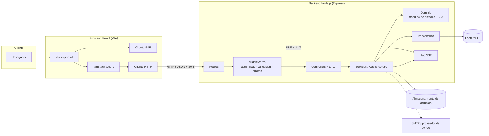
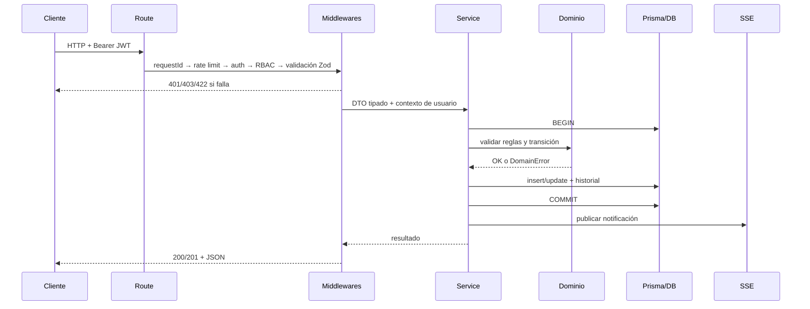
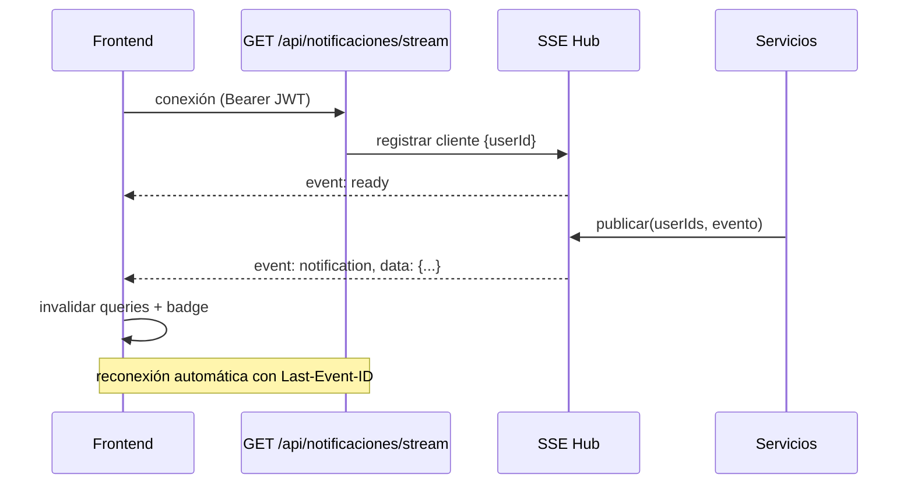

# 03 — Arquitectura del sistema

## 1. Vista general



**Principios:** frontend desacoplado, backend autoritativo, dominio puro y testeable, infraestructura sustituible.

## 2. Arquitectura en capas (backend)

| Capa | Responsabilidad | Puede depender de | No debe |
| :--- | :--- | :--- | :--- |
| Presentación | Rutas, controladores, DTO, middlewares | Aplicación | Acceder a Prisma |
| Aplicación | Casos de uso, transacciones, orquestación | Dominio, repositorios | Conocer `req`/`res` |
| Dominio | Entidades, reglas, máquina de estados, SLA | Nada externo | Importar Express/Prisma |
| Infraestructura | Repositorios Prisma, SSE, archivos, correo | Prisma, librerías | Decidir permisos |

### 2.1. Estructura de `apps/api`

```
apps/api/
├── prisma/
│   ├── schema.prisma
│   ├── migrations/
│   └── seed.ts
├── src/
│   ├── app.ts                     # Express app (sin listen)
│   ├── server.ts                  # bootstrap + graceful shutdown
│   ├── config/
│   │   ├── env.ts                 # validación Zod de variables
│   │   └── logger.ts
│   ├── modules/
│   │   ├── auth/
│   │   │   ├── auth.routes.ts
│   │   │   ├── auth.controller.ts
│   │   │   ├── auth.service.ts
│   │   │   ├── auth.schemas.ts
│   │   │   └── token.service.ts
│   │   ├── users/
│   │   ├── clients/
│   │   ├── technicians/
│   │   ├── catalogs/
│   │   ├── requests/
│   │   │   ├── requests.routes.ts
│   │   │   ├── requests.controller.ts
│   │   │   ├── requests.service.ts   # registro, consulta
│   │   │   ├── workflow.service.ts   # transiciones
│   │   │   ├── assignment.service.ts # asignación/reasignación
│   │   │   ├── sla.service.ts
│   │   │   ├── request.machine.ts
│   │   │   └── requests.schemas.ts
│   │   ├── notifications/
│   │   ├── dashboard/
│   │   └── audit/
│   ├── domain/
│   │   ├── errors.ts
│   │   ├── roles.ts
│   │   └── status.ts
│   ├── infra/
│   │   ├── prisma/client.ts
│   │   ├── repositories/
│   │   ├── sse/hub.ts
│   │   ├── storage/
│   │   └── mail/
│   ├── middlewares/
│   │   ├── authenticate.ts
│   │   ├── authorize.ts
│   │   ├── validate.ts
│   │   ├── error-handler.ts
│   │   ├── request-id.ts
│   │   └── rate-limit.ts
│   └── docs/openapi.ts
└── tests/
    ├── unit/
    ├── integration/
    └── helpers/
```

### 2.2. Estructura de `apps/web`

```
apps/web/src/
├── app/
│   ├── router.tsx
│   ├── providers.tsx
│   └── layouts/            # PublicLayout, AppLayout, RoleGuard
├── features/
│   ├── auth/
│   ├── requests/
│   ├── assignments/
│   ├── clients/
│   ├── technicians/
│   ├── catalogs/
│   ├── dashboard/
│   └── notifications/
├── components/             # UI reutilizable
├── hooks/                  # useAuth, useSSE, usePagination
├── lib/                    # http.ts, queryClient.ts, format.ts
├── styles/
└── main.tsx
```

### 2.3. `packages/shared`

- Enums de estados, prioridades, roles y acciones.
- Esquemas Zod de request/response reutilizados por backend y frontend.
- Tipos TypeScript derivados (`z.infer`).
- Tabla de transiciones permitidas (para deshabilitar acciones en UI; el backend siempre revalida).

## 3. Ciclo de vida de una petición



Reglas:

- `authenticate` valida el JWT y carga `{ userId, role, clientId }` en `res.locals.user`.
- `authorize(...roles)` aplica RBAC; los servicios aplican propiedad/asignación (ABAC).
- `validate(schema)` valida `params`, `query` y `body`; reemplaza el valor por el dato tipado.
- Errores de dominio se traducen a HTTP en un único `error-handler`.
- Toda operación de escritura usa transacción Prisma.

## 4. Autenticación y autorización

### 4.1. Flujo de tokens

1. `POST /api/auth/login` valida credenciales y estado del usuario.
2. Emite **access token** JWT (15 min) con `sub`, `role`, `clientId`, `jti`.
3. Emite **refresh token** opaco (7 días), guardado hasheado en `refresh_tokens`.
4. El refresh token viaja en cookie `HttpOnly`, `Secure` (producción), `SameSite=Strict`, `Path=/api/auth`.
5. El access token se mantiene **en memoria** del frontend (no `localStorage`).
6. `POST /api/auth/refresh` rota el refresh token: revoca el anterior y emite uno nuevo.
7. `POST /api/auth/logout` revoca el refresh y limpia la cookie.
8. Reutilización de un refresh revocado ⇒ se revocan todas las sesiones del usuario y se registra el evento.

### 4.2. Matriz RBAC + ABAC

| Recurso / acción | ADMIN | COORDINADOR | TECNICO | CLIENTE |
| :--- | :-: | :-: | :-: | :-: |
| Usuarios y roles (CRUD) | ✅ | ❌ | ❌ | ❌ |
| Clientes y sedes (CRUD) | ✅ | 👁️ lectura | ❌ | 👁️ solo el suyo |
| Técnicos y especialidades | ✅ | 👁️ lectura | 👁️ su perfil | ❌ |
| Catálogos y parámetros | ✅ | 👁️ lectura | 👁️ lectura | ❌ |
| Crear solicitud | ✅ | ✅ | ❌ | ✅ (su empresa) |
| Listar solicitudes | ✅ todas | ✅ todas | ✅ asignadas | ✅ propias |
| Aprobar / asignar / reasignar | ✅ | ✅ | ❌ | ❌ |
| Iniciar / resolver | ❌ | ❌ | ✅ asignadas | ❌ |
| Cerrar | ✅ | ✅ | ❌ | ✅ propias (RESUELTA) |
| Reabrir | ✅ | ✅ | ❌ | ❌ |
| Historial | ✅ | ✅ | ✅ asignadas | ✅ propias |
| Dashboard global | ✅ | ✅ | ❌ | ❌ |
| Dashboard propio | ✅ | ✅ | ✅ su carga | ✅ sus métricas |
| Notificaciones | ✅ propias | ✅ propias | ✅ propias | ✅ propias |

Leyenda: ✅ permitido · 👁️ solo lectura · ❌ denegado.

**Regla de oro:** el `clientId` y el `technicianId` se derivan del token, nunca de parámetros controlados por el usuario.

## 5. Contratos y validación

- Zod en el borde (DTO) y en el dominio (invariantes).
- `packages/shared` evita divergencias frontend/backend.
- Los schemas de salida eliminan campos sensibles (`password_hash`, `token_hash`, `storage_key`).
- Fechas: se reciben ISO 8601 y se convierten a `Date`; se rechazan fechas inválidas.
- Paginación validada (`page ≥ 1`, `1 ≤ pageSize ≤ 100`).
- Optimistic locking: `PATCH` de solicitud exige `version`; si no coincide → `409 CONFLICTO_VERSION`.

## 6. Manejo de errores

```json
{
  "error": {
    "code": "TRANSICION_INVALIDA",
    "message": "No se puede pasar de CERRADA a EN_PROCESO sin reapertura autorizada.",
    "details": [{ "field": "nuevoEstado", "issue": "transición no permitida" }],
    "requestId": "8f3c2a1e-..."
  }
}
```

- `DomainError` (código + HTTP + mensaje seguro) para reglas de negocio.
- `ZodError` → `422 VALIDACION_FALLIDA` con detalles por campo.
- Errores inesperados → `500 ERROR_INTERNO`, log con `requestId`, sin stack al cliente.
- Catálogo completo en `04-contratos-api.md § 6`.

## 7. Tiempo real (SSE)



- Un `Map<userId, Set<Response>>` en memoria; válido para una instancia.
- Si se escala horizontalmente, se sustituye por Redis Pub/Sub sin cambiar el contrato (ADR-004).
- Heartbeat cada 25 s (`: ping`) para evitar timeouts de proxies.
- El evento incluye `id` incremental para reanudar con `Last-Event-ID`.
- Al cerrar sesión se elimina el cliente del hub.

## 8. Observabilidad

| Aspecto | Implementación |
| :--- | :--- |
| Request ID | Middleware genera/propaga `X-Request-Id`; se incluye en logs y errores. |
| Logs | `pino` JSON con nivel, ruta, método, status, duración, `userId` (sin datos sensibles). |
| Salud | `GET /api/health` → `{ status, db, uptime, version }`. |
| Métricas mínimas | Conteo de 4xx/5xx y latencia por endpoint en logs; opcional Prometheus. |
| Trazabilidad | Cada transición deja historial con actor y fechas. |

## 9. Decisiones de arquitectura (ADR)

### ADR-001 · Express con capas explícitas

- **Contexto:** se requiere Node.js con Express o NestJS y defensa individual del código.
- **Decisión:** Express + TypeScript con separación routes/controllers/services/domain/repositories.
- **Consecuencias:** menor magia, más disciplina manual; se refuerza con lint y revisión.

### ADR-002 · PostgreSQL + Prisma

- **Contexto:** se exige BD relacional con restricciones, índices y migraciones.
- **Decisión:** PostgreSQL 16 y Prisma Migrate.
- **Consecuencias:** migraciones versionadas y tipado; las consultas analíticas complejas del dashboard se escriben con `$queryRaw` parametrizado.

### ADR-003 · JWT corto + refresh rotativo

- **Contexto:** autenticación segura sin sesiones en memoria.
- **Decisión:** access 15 min en memoria + refresh opaco hasheado en cookie HttpOnly con rotación.
- **Consecuencias:** requiere endpoint de refresh y manejo de expiración en el cliente; mayor seguridad ante XSS.

### ADR-004 · SSE para notificaciones

- **Contexto:** se exige una funcionalidad sin recarga manual.
- **Decisión:** SSE unidireccional con reconexión.
- **Consecuencias:** más simple que WebSocket; no sirve para chat bidireccional (fuera de alcance). Escalado horizontal requiere pub/sub externo.

### ADR-005 · Monorepo con contratos compartidos

- **Contexto:** frontend y backend deben coincidir en tipos y validaciones.
- **Decisión:** pnpm workspaces con `packages/shared`.
- **Consecuencias:** un solo `pnpm install`; el pipeline debe compilar el paquete antes de las apps.

### ADR-006 · Estados en catálogo + máquina en dominio

- **Contexto:** la rúbrica exige entidad de estados y transiciones auditadas.
- **Decisión:** tabla `request_statuses` para metadatos y máquina de estados pura en `domain`.
- **Consecuencias:** la UI puede listar estados; la autoridad de transición permanece en el código.

### ADR-007 · Historial append-only

- **Contexto:** auditoría inmutable exigida.
- **Decisión:** tabla sin endpoints de actualización/borrado y, opcionalmente, trigger que bloquee `UPDATE`/`DELETE`.
- **Consecuencias:** crecimiento lineal; se indexa por solicitud y fecha.

### ADR-008 · SLA en horas laborables con pausas

- **Contexto:** el cumplimiento debe calcularse en backend con reglas explícitas.
- **Decisión:** calendario L-V 08:00–17:00, feriados configurables, pausa por `PENDIENTE_INFO`.
- **Consecuencias:** requiere pruebas de borde (viernes, feriado, pausa) y parámetros configurables.

### ADR-009 · Almacenamiento de adjuntos abstraído

- **Contexto:** disco local en desarrollo, objeto en producción.
- **Decisión:** interfaz `StorageAdapter` con implementaciones `LocalStorage` y `S3Storage`.
- **Consecuencias:** la descarga siempre pasa por autorización; no se exponen rutas físicas.

### ADR-010 · Dashboard con SQL agregado

- **Contexto:** se prohíben datos simulados y se exige rendimiento.
- **Decisión:** consultas agregadas en PostgreSQL, expuestas por endpoints con filtros y rango validado.
- **Consecuencias:** se deben crear índices y probar con volumen representativo.

## 10. Restricciones y no objetivos

- Una sola instancia de API para la entrega (sin colas ni microservicios).
- Sin caché distribuida obligatoria; se permite caché en memoria de 60 s para el dashboard.
- Sin integración con sistemas externos salvo SMTP opcional.
- Sin aplicación móvil ni PWA offline.
