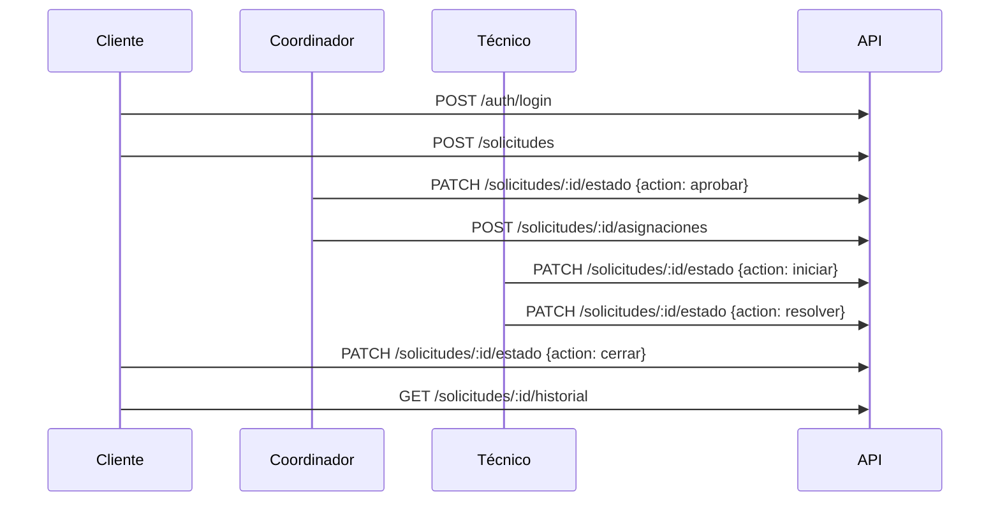

# 04 — Contratos API REST

**Base URL:** `/api` · **Formato:** JSON `application/json; charset=utf-8` · **OpenAPI:** `/api/docs` (Swagger UI) y `/api/openapi.json` · **Versión:** 1.0.

## 1. Convenciones generales

| Aspecto | Regla |
| :--- | :--- |
| Versionado | Prefijo `/api`; cambios incompatibles se documentan y, si aplica, `/api/v2`. |
| Identificadores | UUID v4 en rutas y respuestas. |
| Fechas | ISO 8601 con offset: `2026-11-15T14:30:00-05:00`. |
| Campos | `camelCase` en JSON. |
| Paginación | `page` (≥ 1, default 1), `pageSize` (1–100, default 20). |
| Ordenamiento | `sort=campo` o `sort=-campo` para descendente. |
| Filtros | Query params documentados por endpoint; valores inválidos → `400`. |
| Idempotencia | `POST` de creación no es idempotente; `PATCH` usa `version`. |
| Autenticación | `Authorization: Bearer <accessToken>` salvo endpoints públicos. |
| Content-Type | `application/json`, salvo adjuntos (`multipart/form-data`). |
| CORS | Origen del frontend configurado por `CORS_ORIGIN`. |
| Rate limit | Login 5/15 min por IP+correo; API general 300 req/min por usuario. |

### 1.1. Envelope de éxito

Listados:

```json
{
  "data": [ { "id": "..." } ],
  "meta": { "page": 1, "pageSize": 20, "total": 250, "totalPages": 13 }
}
```

Recurso individual:

```json
{ "data": { "id": "...", "code": "SOL-202611-00042" } }
```

Sin contenido: `204 No Content`.

### 1.2. Envelope de error

```json
{
  "error": {
    "code": "VALIDACION_FALLIDA",
    "message": "La solicitud contiene campos inválidos.",
    "details": [
      { "field": "priority", "issue": "Debe ser CRITICA, ALTA, MEDIA o BAJA." }
    ],
    "requestId": "0f9a7c2e-3b1d-4c8a-9e2f-7d6a5b4c3d2e"
  }
}
```

### 1.3. Códigos HTTP

| Código | Uso |
| :-: | :--- |
| `200` | Consulta o actualización exitosa. |
| `201` | Recurso creado (`Location` cuando aplica). |
| `202` | Aceptado para proceso asíncrono (recuperación de contraseña). |
| `204` | Éxito sin cuerpo (logout, eliminación lógica). |
| `400` | Petición malformada, filtros o fechas inválidas. |
| `401` | No autenticado o token inválido/expirado. |
| `403` | Autenticado sin permiso (rol, propiedad o asignación). |
| `404` | Recurso inexistente o no visible para el usuario. |
| `409` | Conflicto de estado, duplicado, transición o versión. |
| `422` | Validación de campos o regla de negocio violada. |
| `429` | Límite de intentos o de peticiones excedido. |
| `500` | Error interno no controlado. |
| `503` | Dependencia no disponible (BD/correo en health). |

## 2. Autenticación

### 2.1. `POST /api/auth/login` (público)

Solicitud:

```json
{ "email": "coordinador@servigest.ec", "password": "ServiGest2026*" }
```

Respuesta `200`:

```json
{
  "data": {
    "accessToken": "eyJhbGciOiJIUzI1NiIs...",
    "expiresIn": 900,
    "user": {
      "id": "6a1f...",
      "email": "coordinador@servigest.ec",
      "fullName": "Ana Torres",
      "role": "COORDINADOR",
      "clientId": null,
      "mustChangePassword": false
    }
  }
}
```

Además, `Set-Cookie: refresh_token=...; HttpOnly; Secure; SameSite=Strict; Path=/api/auth`.

Errores: `401 CREDENCIALES_INVALIDAS`, `403 USUARIO_INACTIVO`, `429 DEMASIADOS_INTENTOS`.

### 2.2. `POST /api/auth/refresh` (cookie)

Rota el refresh token y devuelve un nuevo access token. `401 REFRESH_INVALIDO` si no existe, expiró o fue revocado.

### 2.3. `POST /api/auth/logout`

Revoca el refresh actual y limpia la cookie. `204`.

### 2.4. `POST /api/auth/forgot-password` (público)

```json
{ "email": "usuario@servigest.ec" }
```

Siempre `202` con `{ "data": { "message": "Si el correo existe, se enviaron instrucciones." } }`.

### 2.5. `POST /api/auth/reset-password` (público)

```json
{ "token": "a1b2c3...", "newPassword": "NuevaClave2026*" }
```

`200` si cumple política; `400 TOKEN_INVALIDO` si expiró/fue usado; `422 PASSWORD_DEBIL`.

### 2.6. `GET /api/auth/me` · `PATCH /api/auth/me` · `PATCH /api/auth/me/password`

Perfil propio y cambio de contraseña (requiere contraseña actual). `PATCH /me` acepta `fullName`, `phone`.

## 3. Reglas de autorización por endpoint

| Endpoint | Roles | Verificación adicional |
| :--- | :--- | :--- |
| `/auth/*` | Público / autenticado | — |
| `/usuarios/*` | ADMIN | No puede desactivarse a sí mismo si es el último admin. |
| `/clientes/*` GET | ADMIN, COORDINADOR | CLIENTE solo ve su empresa vía `/auth/me` y `/solicitudes`. |
| `/clientes/*` escritura | ADMIN | — |
| `/tecnicos/*` escritura | ADMIN | — |
| `/tecnicos/*` GET | ADMIN, COORDINADOR, TECNICO (propio) | — |
| `/catalogos/*` escritura | ADMIN | — |
| `/catalogos/*` GET | Todos los autenticados | — |
| `POST /solicitudes` | CLIENTE, COORDINADOR, ADMIN | CLIENTE: `clientId` se toma del token. |
| `GET /solicitudes` | Todos | Filtro forzado por rol (cliente/técnico). |
| `PATCH /solicitudes/:id/estado` | Según transición | Máquina de estados + asignación. |
| `POST /solicitudes/:id/asignaciones` | ADMIN, COORDINADOR | RN-05. |
| `POST /solicitudes/:id/reabrir` | ADMIN, COORDINADOR | Motivo ≥ 20. |
| `GET /dashboard/*` | ADMIN, COORDINADOR | Filtros de fecha. |
| `GET /dashboard/mi-resumen` | TECNICO, CLIENTE | Solo datos propios. |
| `/notificaciones/*` | Autenticado | Solo propias. |

## 4. Recursos y endpoints

### 4.1. Usuarios y roles

| Método | Ruta | Descripción |
| :--- | :--- | :--- |
| `GET` | `/api/usuarios` | Listado paginado; filtros `role`, `status`, `search`. |
| `POST` | `/api/usuarios` | Crea usuario (ADMIN). Envía invitación/cambio obligatorio. |
| `GET` | `/api/usuarios/:id` | Detalle sin datos sensibles. |
| `PATCH` | `/api/usuarios/:id` | Actualiza nombre, teléfono, rol, estado, `clientId`. |
| `DELETE` | `/api/usuarios/:id` | Desactivación lógica (`204`). |
| `GET` | `/api/roles` | Catálogo de roles. |

`POST /api/usuarios`:

```json
{
  "email": "tecnico2@servigest.ec",
  "fullName": "Luis Vera",
  "phone": "0999999999",
  "role": "TECNICO",
  "clientId": null,
  "temporaryPassword": "Temporal2026*"
}
```

### 4.2. Clientes, sedes y equipos

| Método | Ruta | Descripción |
| :--- | :--- | :--- |
| `GET` | `/api/clientes` | Listado con `search`, `status`. |
| `POST` | `/api/clientes` | Crea cliente (RUC único). |
| `GET` | `/api/clientes/:id` | Detalle con sedes. |
| `PATCH` | `/api/clientes/:id` | Actualiza datos. |
| `DELETE` | `/api/clientes/:id` | Baja lógica; `409 ENTIDAD_EN_USO` si tiene solicitudes activas. |
| `GET` | `/api/clientes/:id/sedes` | Sedes del cliente. |
| `POST` | `/api/clientes/:id/sedes` | Crea sede. |
| `PATCH` | `/api/sedes/:id` | Actualiza sede. |
| `DELETE` | `/api/sedes/:id` | Baja lógica. |
| `GET` | `/api/sedes/:id/equipos` | Equipos de la sede. |
| `POST` | `/api/sedes/:id/equipos` | Crea equipo. |
| `PATCH` | `/api/equipos/:id` | Actualiza equipo. |

### 4.3. Técnicos y especialidades

| Método | Ruta | Descripción |
| :--- | :--- | :--- |
| `GET` | `/api/tecnicos` | Listado; filtros `specialtyId`, `availability`, `status`. |
| `POST` | `/api/tecnicos` | Crea técnico vinculado a usuario `TECNICO` con especialidades. |
| `GET` | `/api/tecnicos/:id` | Detalle, especialidades y carga actual. |
| `PATCH` | `/api/tecnicos/:id` | Actualiza disponibilidad, carga máxima, especialidades. |
| `DELETE` | `/api/tecnicos/:id` | Desactiva (no borra). |
| `GET` | `/api/tecnicos/:id/carga` | `{ vigentes, maximo, disponible }`. |
| `PUT` | `/api/tecnicos/:id/especialidades` | Reemplaza especialidades (≥ 1). |

`POST /api/tecnicos`:

```json
{
  "userId": "b3c2...",
  "employeeCode": "TEC-004",
  "maxConcurrentLoad": 5,
  "availability": "DISPONIBLE",
  "specialties": [
    { "specialtyId": 1, "level": "AVANZADO" },
    { "specialtyId": 3, "level": "INTERMEDIO" }
  ]
}
```

### 4.4. Catálogos y parámetros

| Método | Ruta | Descripción |
| :--- | :--- | :--- |
| `GET/POST` | `/api/especialidades` | Listado / creación. |
| `PATCH/DELETE` | `/api/especialidades/:id` | Actualización / baja lógica. |
| `GET/POST` | `/api/categorias-servicio` | Listado / creación. |
| `PATCH/DELETE` | `/api/categorias-servicio/:id` | Actualización / baja lógica. |
| `GET` | `/api/estados` | Catálogo de estados con orden. |
| `GET` | `/api/parametros` | Parámetros operativos. |
| `PUT` | `/api/parametros/:key` | Actualiza parámetro (ADMIN), auditado. |
| `GET` | `/api/feriados` | Lista de feriados. |
| `POST/DELETE` | `/api/feriados` | Alta/baja de feriado (ADMIN). |

### 4.5. Solicitudes

#### `GET /api/solicitudes`

Query params:

| Parámetro | Tipo | Descripción |
| :--- | :--- | :--- |
| `page`, `pageSize` | int | Paginación. |
| `status` | string | Código de estado (puede repetirse). |
| `priority` | string | Prioridad. |
| `clientId` | uuid | Solo ADMIN/COORDINADOR. |
| `technicianId` | uuid | Solo ADMIN/COORDINADOR. |
| `categoryId` | int | Categoría. |
| `overdue` | bool | Solo vencidas. |
| `search` | string | Código o descripción. |
| `from`, `to` | date | Rango de creación (`YYYY-MM-DD`). |
| `sort` | string | `createdAt`, `dueAt`, `priority`, `status`. |

Respuesta `200`:

```json
{
  "data": [
    {
      "id": "f1e2...",
      "code": "SOL-202611-00042",
      "client": { "id": "...", "businessName": "Constructora Andina S.A." },
      "site": { "id": "...", "name": "Planta Norte" },
      "category": { "id": 3, "name": "Mantenimiento eléctrico" },
      "priority": "ALTA",
      "status": "ASIGNADA",
      "assignedTechnician": { "id": "...", "fullName": "Luis Vera" },
      "dueAt": "2026-11-17T16:00:00-05:00",
      "isOverdue": false,
      "createdAt": "2026-11-15T09:10:00-05:00"
    }
  ],
  "meta": { "page": 1, "pageSize": 20, "total": 1, "totalPages": 1 }
}
```

#### `POST /api/solicitudes`

```json
{
  "siteId": "d4c3...",
  "assetId": "e5f6...",
  "categoryId": 3,
  "priority": "ALTA",
  "description": "El tablero principal presenta sobrecalentamiento intermitente."
}
```

`201` con la solicitud creada (`status: REGISTRADA`, `code`, `dueAt`, `version: 1`). El `clientId` se deriva del token si el rol es CLIENTE.

Errores: `404 SEDE_NO_ENCONTRADA`, `422 CATEGORIA_INVALIDA`, `422 SEDE_NO_PERTENECE_AL_CLIENTE`.

#### `GET /api/solicitudes/:id`

Devuelve detalle completo: solicitud, cliente, sede, equipo, categoría, asignación vigente, últimos eventos y adjuntos.

#### `PATCH /api/solicitudes/:id`

Edita `description`, `priority`, `assetId`, `categoryId` según estado/rol. Requiere `version`:

```json
{ "priority": "CRITICA", "version": 3 }
```

`409 CONFLICTO_VERSION` si otro usuario modificó antes. Cambiar prioridad recalcula `dueAt`.

#### `PATCH /api/solicitudes/:id/estado`

```json
{
  "action": "resolver",
  "comment": "Se reemplazó el breaker y se verificó carga.",
  "resolution": "Se reemplazó el breaker de 100A, se ajustaron conexiones y se realizaron pruebas de carga sin anomalías.",
  "version": 5
}
```

`action` ∈ `aprobar`, `cancelar`, `iniciar`, `solicitar_info`, `reanudar`, `resolver`, `cerrar`, `reabrir_trabajo`.

`200` con la solicitud actualizada y el evento de historial. Errores: `409 TRANSICION_INVALIDA`, `403 SIN_ASIGNACION`, `422 RESOLUCION_REQUERIDA`, `422 MOTIVO_REQUERIDO`.

#### `POST /api/solicitudes/:id/asignaciones`

```json
{
  "technicianId": "a1b2...",
  "reason": null,
  "version": 2
}
```

Reasignación: `reason` obligatorio (≥ 10). `201` con asignación. Errores: `409 ESPECIALIDAD_INCOMPATIBLE`, `409 TECNICO_NO_DISPONIBLE`, `409 CARGA_EXCEDIDA`, `409 ASIGNACION_VIGENTE`.

#### `POST /api/solicitudes/:id/reabrir`

```json
{
  "reason": "El cliente reporta que la falla persiste tras el cierre.",
  "version": 9
}
```

Solo ADMIN/COORDINADOR, estado `CERRADA`, motivo ≥ 20. Genera evento `REAPERTURA` y notificación.

#### `GET /api/solicitudes/:id/historial`

```json
{
  "data": [
    {
      "id": 41,
      "action": "TRANSICION",
      "fromStatus": "REGISTRADA",
      "toStatus": "APROBADA",
      "actor": { "id": "...", "fullName": "Ana Torres", "role": "COORDINADOR" },
      "comment": "Aprobada para atención.",
      "metadata": null,
      "createdAt": "2026-11-15T09:30:00-05:00"
    }
  ]
}
```

#### Adjuntos

| Método | Ruta | Descripción |
| :--- | :--- | :--- |
| `POST` | `/api/solicitudes/:id/adjuntos` | `multipart/form-data`, campo `file`; ≤ 10 MB. |
| `GET` | `/api/solicitudes/:id/adjuntos` | Lista metadatos. |
| `GET` | `/api/solicitudes/:id/adjuntos/:attachmentId` | Descarga autorizada (`Content-Disposition: attachment`). |
| `DELETE` | `/api/solicitudes/:id/adjuntos/:attachmentId` | Solo ADMIN/COORDINADOR o autor antes de `CERRADA`. |

### 4.6. Notificaciones

| Método | Ruta | Descripción |
| :--- | :--- | :--- |
| `GET` | `/api/notificaciones` | Paginado; `unread=true`. |
| `PATCH` | `/api/notificaciones/:id/leida` | Marca una como leída. |
| `POST` | `/api/notificaciones/leer-todas` | Marca todas. `204`. |
| `GET` | `/api/notificaciones/stream` | SSE. `text/event-stream`. |

Evento SSE:

```
id: 1024
event: notification
data: {"id":"...","type":"CAMBIO_ESTADO","title":"Solicitud resuelta","body":"SOL-202611-00042 pasó a RESUELTA","requestId":"..."}

```

### 4.7. Dashboard

| Método | Ruta | Roles | Descripción |
| :--- | :--- | :--- | :--- |
| `GET` | `/api/dashboard/indicadores` | ADMIN, COORDINADOR | Totales y series del rango. |
| `GET` | `/api/dashboard/carga-tecnicos` | ADMIN, COORDINADOR | Carga y capacidad por técnico. |
| `GET` | `/api/dashboard/evolucion` | ADMIN, COORDINADOR | Serie temporal por día/semana. |
| `GET` | `/api/dashboard/mi-resumen` | TECNICO, CLIENTE | Resumen propio. |

Query: `from`, `to` (obligatorios, máximo 366 días), `granularity=day|week`, `clientId`, `categoryId`.

Respuesta `200`:

```json
{
  "data": {
    "range": { "from": "2026-10-01", "to": "2026-10-31" },
    "byStatus": [ { "status": "CERRADA", "count": 42 } ],
    "byPriority": [ { "priority": "ALTA", "count": 18 } ],
    "technicianLoad": [
      { "technicianId": "...", "fullName": "Luis Vera", "active": 3, "capacity": 5 }
    ],
    "avgResolutionHours": 6.4,
    "slaCompliance": { "within": 38, "total": 42, "percentage": 90.48 },
    "overdue": 5,
    "evolution": [ { "date": "2026-10-01", "created": 4, "resolved": 3 } ]
  }
}
```

`400 RANGO_INVALIDO` si `from > to` o supera 366 días. Sin datos ⇒ arreglos vacíos y ceros.

### 4.8. Salud y metadatos

| Método | Ruta | Descripción |
| :--- | :--- | :--- |
| `GET` | `/api/health` | `{ status, db, uptime, version }`. |
| `GET` | `/api/docs` | Swagger UI. |
| `GET` | `/api/openapi.json` | Documento OpenAPI 3.1. |

## 5. Catálogo de códigos de error

| Código | HTTP | Significado |
| :--- | :-: | :--- |
| `VALIDACION_FALLIDA` | 422 | Uno o más campos inválidos. |
| `CREDENCIALES_INVALIDAS` | 401 | Correo o contraseña incorrectos. |
| `USUARIO_INACTIVO` | 403 | Usuario deshabilitado. |
| `DEMASIADOS_INTENTOS` | 429 | Rate limit de login. |
| `TOKEN_INVALIDO` | 400/401 | Token ausente, vencido o reutilizado. |
| `REFRESH_INVALIDO` | 401 | Refresh inexistente, vencido o revocado. |
| `SIN_PERMISO` | 403 | Rol sin autorización. |
| `SIN_ASIGNACION` | 403 | Técnico sin asignación vigente. |
| `RECURSO_NO_ENCONTRADO` | 404 | Recurso inexistente o no visible. |
| `CLIENTE_DUPLICADO` | 409 | RUC ya registrado. |
| `EMAIL_DUPLICADO` | 409 | Correo ya registrado. |
| `ENTIDAD_EN_USO` | 409 | No se puede eliminar por relaciones activas. |
| `TRANSICION_INVALIDA` | 409 | Cambio de estado no permitido. |
| `SOLICITUD_CERRADA` | 409 | Operación no permitida sobre cerrada. |
| `CONFLICTO_VERSION` | 409 | Bloqueo optimista. |
| `ASIGNACION_VIGENTE` | 409 | Ya existe asignación vigente. |
| `ESPECIALIDAD_INCOMPATIBLE` | 409 | Técnico sin la especialidad requerida. |
| `TECNICO_NO_DISPONIBLE` | 409 | Técnico inactivo/no disponible. |
| `CARGA_EXCEDIDA` | 409 | Carga máxima alcanzada. |
| `TECNICO_SIN_ESPECIALIDAD` | 422 | Técnico sin especialidades. |
| `RESOLUCION_REQUERIDA` | 422 | Cierre sin resolución documentada. |
| `MOTIVO_REQUERIDO` | 422 | Cancelación/reasignación/reapertura sin motivo. |
| `ADJUNTO_INVALIDO` | 422 | Tipo o tamaño no permitido. |
| `RANGO_INVALIDO` | 400 | Fechas del dashboard inválidas. |
| `ERROR_INTERNO` | 500 | Error no controlado. |

## 6. Estrategia OpenAPI

- Un documento OpenAPI 3.1 generado desde anotaciones JSDoc/`zod-to-openapi`.
- Schemas reutilizados desde `packages/shared`.
- Cada endpoint documenta: resumen, roles, parámetros, body, respuestas (incluidos errores) y ejemplo.
- `securitySchemes.bearerAuth` (JWT) documentado.
- La verificación de OpenAPI falla si el documento no se genera o si un endpoint carece de descripción.
- Swagger UI disponible solo en desarrollo y en la demo; en producción se puede proteger con autenticación básica.

## 7. Ejemplo de flujo completo (contrato)


