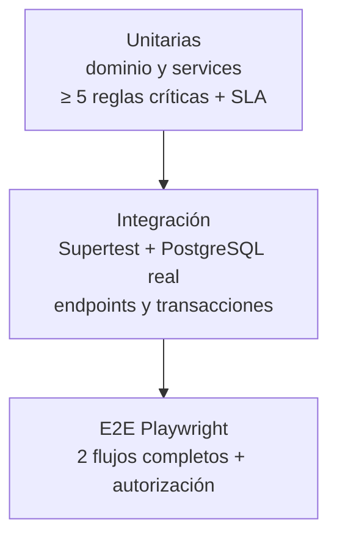

# 05 — Plan de pruebas y aseguramiento de calidad

**Objetivo:** demostrar con evidencia verificable que el sistema cumple los requisitos, las reglas de negocio y las restricciones de seguridad, no solo que “funciona en local”.

## 1. Estrategia (pirámide)



| Nivel | Herramienta | Alcance | Objetivo |
| :--- | :--- | :--- | :--- |
| Unitarias | Vitest | Máquina de estados, SLA, validaciones, asignación, autorización pura | Rápida realimentación; 80 % en `domain` y `services`. |
| Integración | Vitest + Supertest + PostgreSQL (contenedor o esquema de prueba) | Endpoints, Prisma, transacciones, historial, SSE | Verificar contratos y persistencia real. |
| E2E | Playwright | Navegador real, dos flujos completos | Verificar integración frontend-backend. |
| Manuales | Checklist | Responsive, accesibilidad, estados de UI | Complementar lo automatizable. |

**Principios:**

- Sin mocks de base de datos en integración; se usa PostgreSQL real.
- Cada prueba crea y limpia sus datos (transacción por test o `truncate` controlado).
- Los tests no dependen del orden de ejecución.
- Datos sensibles de prueba solo en el entorno de test.
- Se ejecutan en CI en cada push y obligatoriamente antes del merge.

## 2. Entornos de prueba

| Entorno | Base de datos | Uso |
| :--- | :--- | :--- |
| Local unitario | Sin BD | Dominio puro. |
| Local integración | PostgreSQL en Docker (`servigest_test`) | Endpoints y repositorios. |
| CI | Servicio PostgreSQL efímero | Pipeline. |
| Demo | Datos seed | E2E y presentación. |

Comandos previstos:

```
pnpm test            # unitarias
pnpm test:integration
pnpm test:e2e
pnpm test:coverage
```

## 3. Pruebas unitarias de reglas críticas (obligatorias)

### TC-RN-01 · Cierre sin resolución documentada

| Caso | Entrada | Esperado |
| :--- | :--- | :--- |
| TC-RN-01-01 | `RESUELTA` + `resolution = null` | `DomainError RESOLUCION_REQUERIDA` |
| TC-RN-01-02 | `RESUELTA` + `resolution` de 29 caracteres | Error de validación |
| TC-RN-01-03 | `RESUELTA` + resolución válida + rol CLIENTE dueño | Transición a `CERRADA` |
| TC-RN-01-04 | `RESUELTA` + resolución válida + rol TECNICO | `SIN_PERMISO` |

### TC-RN-02 · Alcance del técnico

| Caso | Entrada | Esperado |
| :--- | :--- | :--- |
| TC-RN-02-01 | Técnico A cambia estado de solicitud asignada a B | `SIN_ASIGNACION` |
| TC-RN-02-02 | Técnico A resuelve solicitud asignada a A | Éxito |
| TC-RN-02-03 | Técnico A consulta solicitud de B | `404`/`403` sin filtrar datos |
| TC-RN-02-04 | Asignación finalizada (histórica) | `SIN_ASIGNACION` |

### TC-RN-03 · Aislamiento de clientes

| Caso | Entrada | Esperado |
| :--- | :--- | :--- |
| TC-RN-03-01 | Cliente 1 lista solicitudes | Solo las de cliente 1 |
| TC-RN-03-02 | Cliente 1 fuerza `clientId=2` | Filtro ignorado, solo cliente 1 |
| TC-RN-03-03 | Cliente 1 consulta detalle de cliente 2 | `404` |
| TC-RN-03-04 | Cliente 1 intenta adjuntar a solicitud ajena | `404` |

### TC-RN-04 · Reapertura y estados terminales

| Caso | Entrada | Esperado |
| :--- | :--- | :--- |
| TC-RN-04-01 | `CERRADA → EN_PROCESO` | `SOLICITUD_CERRADA` |
| TC-RN-04-02 | `CERRADA → APROBADA` con COORDINADOR y motivo 20+ | Éxito + evento `REAPERTURA` |
| TC-RN-04-03 | Reapertura sin motivo | `MOTIVO_REQUERIDO` |
| TC-RN-04-04 | Reapertura por CLIENTE | `SIN_PERMISO` |
| TC-RN-04-05 | `CANCELADA → cualquier estado` | `TRANSICION_INVALIDA` |

### TC-RN-05 · Validación de asignación

| Caso | Entrada | Esperado |
| :--- | :--- | :--- |
| TC-RN-05-01 | Técnico con especialidad, disponible, carga < máximo | Éxito |
| TC-RN-05-02 | Técnico sin la especialidad de la categoría | `ESPECIALIDAD_INCOMPATIBLE` |
| TC-RN-05-03 | Técnico `NO_DISPONIBLE` | `TECNICO_NO_DISPONIBLE` |
| TC-RN-05-04 | Técnico con carga = máximo | `CARGA_EXCEDIDA` |
| TC-RN-05-05 | Reasignar sin motivo | `MOTIVO_REQUERIDO` |
| TC-RN-05-06 | Reasignar con dos asignaciones vigentes | Invariante INV-02 se mantiene |

### TC-RN-06 · Cálculo de SLA

| Caso | Entrada | Esperado |
| :--- | :--- | :--- |
| TC-RN-06-01 | Creada lunes 09:00, prioridad ALTA (8 h) | Vence martes 08:00 (7 h lunes + 1 h martes) |
| TC-RN-06-02 | Creada viernes 15:00, prioridad ALTA (8 h) | Vence martes 10:00 (2 h vie + 6 h lun) |
| TC-RN-06-03 | Feriado intermedio | Se salta el feriado |
| TC-RN-06-04 | Pausa de 60 min en `PENDIENTE_INFO` | `dueAt` se extiende 60 min laborables |
| TC-RN-06-05 | Cambio de prioridad MEDIA→CRITICA | `dueAt` se recalcula |
| TC-RN-06-06 | `now > dueAt` y estado abierto | `isOverdue = true` |
| TC-RN-06-07 | `now > dueAt` pero `RESUELTA` | `isOverdue = false` |

### TC-RN-07 · Auditoría

| Caso | Entrada | Esperado |
| :--- | :--- | :--- |
| TC-RN-07-01 | Transición exitosa | Se crea exactamente un evento con actor y fechas |
| TC-RN-07-02 | Falla la transacción | No queda evento huérfano |
| TC-RN-07-03 | Intento de `PATCH`/`DELETE` al historial | `404`/`405`; no existe endpoint |

### TC-RN-08 · Concurrencia

| Caso | Entrada | Esperado |
| :--- | :--- | :--- |
| TC-RN-08-01 | Dos `PATCH` con la misma `version` | Uno responde `200`, el otro `409 CONFLICTO_VERSION` |
| TC-RN-08-02 | Dos asignaciones simultáneas | Solo una asignación `VIGENTE` |

## 4. Pruebas de integración (endpoints)

Matriz mínima: cada endpoint con un caso positivo y los negativos indicados.

| Endpoint | Positivo | Negativos obligatorios |
| :--- | :--- | :--- |
| `POST /auth/login` | Credenciales válidas | 401, 403 inactivo, 429, 422 formato |
| `POST /auth/refresh` | Rotación correcta | 401 sin cookie, revocado, expirado |
| `POST /auth/forgot-password` | 202 siempre | Correo inexistente (misma respuesta) |
| `POST /auth/reset-password` | Cambio y revocación de sesiones | Token usado, expirado, password débil |
| `GET /usuarios` | ADMIN | 403 para los otros roles |
| `POST /clientes` | 201 | 409 RUC duplicado, 422 |
| `DELETE /clientes/:id` | Baja lógica | 409 entidad en uso |
| `POST /tecnicos` | 201 con especialidades | 422 sin especialidades, 409 usuario ya técnico |
| `POST /solicitudes` | 201 con `code` y `dueAt` | 422 campos, 404 sede, 403 categoría |
| `GET /solicitudes` | Paginación y filtros | 400 fechas, aislamiento por rol |
| `GET /solicitudes/:id` | 200 | 404 ajeno, 401 sin token |
| `PATCH /solicitudes/:id` | 200 con versión correcta | 409 versión, 403 rol, 422 |
| `PATCH /solicitudes/:id/estado` | Cada transición válida | 409 inválida, 403, 422 motivo/resolución |
| `POST /solicitudes/:id/asignaciones` | 201 | 409 especialidad/carga/disponibilidad, 403 |
| `POST /solicitudes/:id/reabrir` | 200 + evento | 409 estado, 403 rol, 422 motivo |
| `GET /solicitudes/:id/historial` | Orden cronológico | 403 ajeno |
| `POST /solicitudes/:id/adjuntos` | 201 | 422 tipo/tamaño, 404 ajena |
| `GET /notificaciones` | Solo propias | 401 |
| `GET /notificaciones/stream` | `text/event-stream` y evento | 401 |
| `GET /dashboard/indicadores` | Datos reales | 400 rango, 403 rol |
| `GET /health` | 200 con `db: up` | 503 con BD caída |

### 4.1. Verificación de persistencia

- La solicitud creada existe en BD con todos los campos calculados.
- La transición actualiza estado, timestamps y `version` atómicamente.
- El historial contiene el evento con el actor correcto.
- La asignación anterior queda `FINALIZADA` y la nueva `VIGENTE`.
- No se almacenan contraseñas en claro ni tokens sin hash.
- Los adjuntos se guardan con clave aleatoria y no con el nombre original como ruta.

## 5. Pruebas de autorización por roles

Matriz automatizada: para cada rol, invocar cada endpoint protegido y verificar `200/201/204` o `403`.

| Rol | Casos clave |
| :--- | :--- |
| ADMIN | Todo permitido salvo operaciones exclusivas de técnico asignado. |
| COORDINADOR | No puede gestionar usuarios ni parámetros. |
| TECNICO | Solo solicitudes asignadas; no puede asignar, aprobar, cerrar ni reabrir. |
| CLIENTE | Solo su empresa; no puede ver catálogos internos de carga ni dashboard global. |
| Sin token | Todo endpoint privado → `401`. |
| Token expirado | → `401 TOKEN_INVALIDO`. |
| Token manipulado | → `401`. |
| Rol inexistente en token | → `401`. |

Se incluye prueba de **IDOR**: cambiar el UUID de la URL por uno de otro cliente/técnico y verificar `404`/`403` sin filtración de datos.

## 6. Pruebas E2E (dos flujos obligatorios)

### E2E-01 · Registro → asignación → atención

1. Cliente inicia sesión y registra una solicitud con adjunto.
2. Verifica que aparece en “Mis solicitudes” con estado `REGISTRADA`.
3. Coordinador inicia sesión, la aprueba y asigna un técnico válido.
4. Técnico inicia sesión, ve solo su solicitud, la inicia y la resuelve con resolución.
5. Se verifica la notificación SSE en la sesión del cliente (sin recargar).
6. Se valida el historial con 5 eventos y los usuarios correctos.

### E2E-02 · Consulta → seguimiento → cierre

1. Cliente consulta una solicitud `RESUELTA`.
2. Verifica la resolución documentada y el historial.
3. Cierra la solicitud; el estado pasa a `CERRADA`.
4. Intenta cambiar el estado y el sistema lo impide.
5. Coordinador reabre con motivo y la solicitud vuelve a `APROBADA`.
6. El historial registra la reapertura y el dashboard refleja el cambio.

## 7. Pruebas no funcionales y manuales

| Área | Verificación | Evidencia |
| :--- | :--- | :--- |
| Responsive | 360, 768, 1024, 1440 px en login, listado, detalle y dashboard | Capturas |
| Estados UI | Carga (skeleton), error (reintento), vacío (mensaje y CTA) | Capturas |
| Accesibilidad | Teclado, foco visible, contraste AA, labels, `aria-live` en notificaciones | Checklist + Lighthouse |
| Rendimiento | Seed de 10 000 solicitudes; medir p95 de listado y dashboard | Reporte de tiempos |
| Seguridad | Hash, JWT, rate limit, IDOR, CORS, cabeceras (`helmet`) | Resultados de pruebas |
| Recuperación | Reinicio de API y reconexión SSE | Video/captura |
| Despliegue | Instalación desde cero con README | Log del despliegue |

## 8. Datos de prueba

- Seed reproducible descrito en `02-modelo-dominio.md § 7`.
- Usuarios demo por rol con credenciales documentadas solo para desarrollo.
- 60 solicitudes mínimas; para rendimiento, un seed extendido de 10 000.
- Casos borde incluidos: solicitud vencida, cerrada, cancelada, pendiente de información, sin asignación y con múltiples transiciones.

## 9. Evidencias y reporte de defectos

### 9.1. Estructura del informe

1. Resumen ejecutivo y alcance.
2. Entorno y versiones.
3. Resultados por nivel (unitarias, integración, E2E, manuales).
4. Tabla de requisitos cubiertos y no cubiertos.
5. Defectos detectados.
6. Acciones correctivas y reintentos.
7. Conclusiones y riesgos residuales.

### 9.2. Registro de defectos

| ID | Requisito | Descripción | Severidad | Estado | Acción | Evidencia |
| :--- | :--- | :--- | :--- | :--- | :--- | :--- |
| DEF-001 | RN-04 | Reapertura permitía motivo vacío | Alta | Corregido | Validación Zod + test | TC-RN-04-03 |
| DEF-002 | NFR-USA-01 | Tabla sin estado vacío | Media | Corregido | Componente `EmptyState` | Captura |

Severidad: **Crítica** (bloquea flujo/seguridad), **Alta** (regla incumplida), **Media** (UX/datos secundarios), **Baja** (cosmético).

### 9.3. Criterios de salida

- 100 % de las reglas de negocio con al menos una prueba automatizada en verde.
- 0 defectos críticos o altos abiertos.
- Todos los endpoints de la matriz de integración cubiertos.
- Los dos flujos E2E pasan en CI.
- Cobertura ≥ 80 % en `domain` y `services`.
- Informe de pruebas con evidencias adjuntas.

## 10. Trazabilidad de pruebas

Cada caso `TC-*` referencia su requisito `RF-*`/`RN-*` y su tarea `T-*` en `10-trazabilidad.md`. No se acepta una regla de negocio sin caso de prueba asociado.
