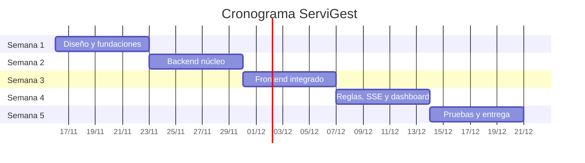
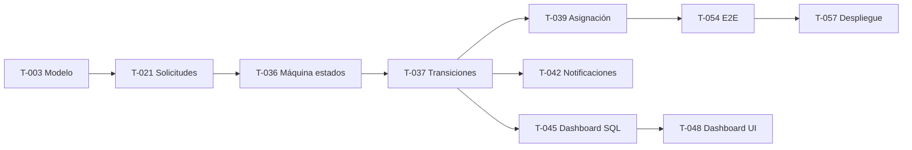

# 06 — Backlog de tareas y planificación

**Duración:** 5 semanas · **Equipo:** 4 integrantes · **Metodología:** SDD + tablero Kanban con revisión por pares.

## 1. Roles del equipo

| Código | Integrante | Rol principal | Responsabilidades transversales |
| :--- | :--- | :--- | :--- |
| JAR | **Jared Ochoa** | Backend / Base de datos / Seguridad | Modelo, migraciones, auth, usuarios, catálogos, revisión de contratos API |
| JER | **Jeremy Marquez** | Backend / Reglas de negocio | Solicitudes, máquina de estados, SLA, asignaciones, auditoría, dashboard SQL |
| NEI | **Neil Goyes** | Frontend | Rutas, formularios, flujos, estados UI, accesibilidad, manual de usuario |
| CRI | **Cristhian Loor** | Full stack / QA / despliegue | Notificaciones SSE, pruebas E2E, despliegue, manual técnico, informe y video |

> La asignación detallada por integrante, entidades, endpoints, contratos y handoffs está en [`11-plan-equipo.md`](11-plan-equipo.md). Todos revisan código de todos y deben poder explicar y modificar en vivo cualquier módulo (defensa individual de 3 puntos).

## 2. Convenciones del tablero

Estados: `Backlog → Listo → En curso → En revisión → Hecho`.
Límite WIP: 1 tarea “En curso” por persona.
Cada tarea incluye: ID, requisito, descripción, criterio de aceptación, dependencias y estimación en puntos (1 = ~2 h; 2 = ~4 h; 3 = ~6 h; 5 = ~1 día).

## 3. Épicas

| Épica | Nombre | Requisitos |
| :--- | :--- | :--- |
| EP-01 | Fundaciones y modelo de datos | RF-USR, RF-CLI, RF-TEC, RF-CAT |
| EP-02 | Seguridad y autenticación | RF-AUTH, NFR-SEG |
| EP-03 | Gestión de solicitudes | RF-SOL |
| EP-04 | Asignación, SLA y auditoría | RF-ASI, RF-AUD, RN-01…RN-08 |
| EP-05 | Notificaciones en tiempo real | RF-NOT |
| EP-06 | Dashboard y reportes | RF-DASH |
| EP-07 | Frontend y experiencia | NFR-USA |
| EP-08 | Pruebas, despliegue y documentación | Todos |

## 4. Tareas

### Semana 1 · Análisis, diseño y fundaciones

| ID | Tarea | Épica | Req. | Resp. | Pts | Depende |
| :--- | :--- | :--- | :--- | :-: | :-: | :--- |
| T-001 | Ratificar decisiones abiertas y ADR | EP-08 | — | JAR | 1 | — |
| T-002 | Crear monorepo pnpm, lint, typecheck, tsconfig | EP-01 | — | JAR | 2 | — |
| T-003 | `schema.prisma` completo y migración inicial | EP-01 | RF-* | JAR | 3 | T-002 |
| T-004 | Seed idempotente con roles, usuarios y catálogos | EP-01 | RF-CAT | JAR | 2 | T-003 |
| T-005 | Seed de 60 solicitudes e historial coherente | EP-01 | RF-SOL | JER | 2 | T-003 |
| T-006 | Paquete `shared`: enums, estados y esquemas Zod | EP-01 | — | NEI | 2 | T-002 |
| T-007 | Esqueleto Express, config env, logger, requestId | EP-01 | — | JAR | 2 | T-002 |
| T-008 | Middleware de errores y `DomainError` | EP-01 | NFR-USA-03 | JAR | 1 | T-007 |
| T-009 | Docker Compose (PostgreSQL + API + web) | EP-08 | NFR-PORT-01 | CRI | 2 | T-002 |
| T-010 | Publicar OpenAPI base y Swagger UI | EP-08 | NFR-DOC-01 | JAR | 2 | T-007 |

### Semana 2 · Autenticación y API núcleo

| ID | Tarea | Épica | Req. | Resp. | Pts | Depende |
| :--- | :--- | :--- | :--- | :-: | :-: | :--- |
| T-011 | Hash de contraseñas y política | EP-02 | RF-AUTH-01, NFR-SEG-01 | JAR | 1 | T-007 |
| T-012 | Login, logout y `/auth/me` | EP-02 | RF-AUTH-01/02/05 | JAR | 3 | T-011 |
| T-013 | Refresh rotativo con cookie HttpOnly | EP-02 | RF-AUTH-03, NFR-SEG-02 | JAR | 3 | T-012 |
| T-014 | Recuperación de contraseña con token de un uso | EP-02 | RF-AUTH-04 | JAR | 3 | T-011 |
| T-015 | Middlewares `authenticate` + `authorize` | EP-02 | NFR-SEG-03 | JAR | 2 | T-012 |
| T-016 | Rate limit de login y bloqueo temporal | EP-02 | NFR-SEG-04 | JAR | 2 | T-012 |
| T-017 | CRUD usuarios y roles | EP-01 | RF-USR-01/02 | JAR | 3 | T-015 |
| T-018 | CRUD clientes, sedes y equipos | EP-01 | RF-CLI-01/02/03 | JAR | 3 | T-015 |
| T-019 | CRUD técnicos y especialidades | EP-01 | RF-TEC-01/02 | JAR | 3 | T-017 |
| T-020 | CRUD catálogos, parámetros y feriados | EP-01 | RF-CAT-01…04 | JAR | 3 | T-015 |
| T-021 | Registro de solicitud con código único y `dueAt` | EP-03 | RF-SOL-01, RN-09 | JER | 3 | T-018, T-020 |
| T-022 | Listado paginado y filtrado por rol | EP-03 | RF-SOL-02, RN-03 | JER | 3 | T-021 |
| T-023 | Detalle y edición con bloqueo optimista | EP-03 | RF-SOL-03/04, RN-08 | JER | 3 | T-021 |
| T-024 | Motor de SLA con calendario laboral | EP-04 | RN-06, NFR-PERF | JER | 5 | T-020 |
| T-025 | Pruebas unitarias de SLA (7 casos) | EP-08 | TC-RN-06 | CRI | 2 | T-024 |

### Semana 3 · Frontend y flujos integrados

| ID | Tarea | Épica | Req. | Resp. | Pts | Depende |
| :--- | :--- | :--- | :--- | :-: | :-: | :--- |
| T-026 | Cliente HTTP, manejo de tokens y refresh automático | EP-07 | NFR-SEG-02 | NEI | 3 | T-013 |
| T-027 | Login, logout y recuperación de contraseña (UI) | EP-07 | RF-AUTH | NEI | 3 | T-026 |
| T-028 | Layout, navegación por rol y rutas protegidas | EP-07 | NFR-SEG-03 | NEI | 3 | T-026 |
| T-029 | CRUD de clientes, sedes y técnicos (UI) | EP-07 | RF-CLI/TEC | NEI | 3 | T-027 |
| T-030 | Formulario de registro de solicitud con adjuntos | EP-07 | RF-SOL-01/07 | NEI | 3 | T-021, T-026 |
| T-031 | Listado con filtros, paginación y estados UI | EP-07 | RF-SOL-02, NFR-USA-01 | NEI | 3 | T-022, T-028 |
| T-032 | Detalle, timeline de historial y acciones por estado | EP-07 | RF-SOL-03, RF-AUD-01 | NEI | 3 | T-023 |
| T-033 | UI de aprobación y asignación/reasignación | EP-07 | RF-ASI-01/02 | NEI | 3 | T-032 |
| T-034 | UI de operación del técnico (iniciar, resolver, info) | EP-07 | RF-SOL-05/08 | NEI | 3 | T-032 |
| T-035 | Componentes de carga, error y vacío reutilizables | EP-07 | NFR-USA-01 | NEI | 2 | T-028 |

### Semana 4 · Reglas avanzadas, realtime y dashboard

| ID | Tarea | Épica | Req. | Resp. | Pts | Depende |
| :--- | :--- | :--- | :--- | :-: | :-: | :--- |
| T-036 | Máquina de estados y matriz de transiciones | EP-04 | RF-SOL-05, RN-01/04 | JER | 5 | T-021 |
| T-037 | Endpoint de transición con historial transaccional | EP-04 | RN-07, NFR-REL-01 | JER | 3 | T-036 |
| T-038 | Reapertura auditada | EP-04 | RF-SOL-06, RN-04 | JER | 2 | T-037 |
| T-039 | Validación de asignación (especialidad, carga, disponibilidad) | EP-04 | RF-ASI-01, RN-05 | JER | 3 | T-019, T-036 |
| T-040 | Reasignación con motivo y cierre de asignación previa | EP-04 | RF-ASI-02, RN-11/12 | JER | 3 | T-039 |
| T-041 | Endpoint de historial inmutable | EP-04 | RF-AUD-01, RN-07 | JER | 2 | T-037 |
| T-042 | Notificaciones persistentes por evento | EP-05 | RF-NOT-01/03 | CRI | 3 | T-037 |
| T-043 | Hub SSE y endpoint de stream | EP-05 | RF-NOT-02, NFR-PERF-03 | CRI | 3 | T-042 |
| T-044 | Cliente SSE, badge y toasts en React | EP-05 | RF-NOT-02 | NEI | 2 | T-043, T-028 |
| T-045 | Consultas SQL de indicadores (estado, prioridad, carga) | EP-06 | RF-DASH-01/02 | JER | 5 | T-037 |
| T-046 | SLA, cumplimiento, vencidas y evolución | EP-06 | RF-DASH-03, RN-06 | JER | 3 | T-024, T-045 |
| T-047 | Endpoints de dashboard con filtros y permisos | EP-06 | RF-DASH-01/03 | JER | 3 | T-045 |
| T-048 | UI de dashboard con gráficos y filtros | EP-06 | RF-DASH | NEI | 5 | T-047, T-035 |
| T-049 | Adjuntos: subida, validación y descarga autorizada | EP-03 | RF-SOL-07, RN-14 | JAR | 3 | T-021 |
| T-050 | Auditoría de cambios de parámetros y usuarios | EP-04 | RN-07 | JAR | 2 | T-020 |

### Semana 5 · Pruebas, despliegue y defensa

| ID | Tarea | Épica | Req. | Resp. | Pts | Depende |
| :--- | :--- | :--- | :--- | :-: | :-: | :--- |
| T-051 | Suite unitaria de RN-01…RN-08 | EP-08 | TC-RN-* | CRI, JER | 5 | T-036…T-041 |
| T-052 | Suite de integración de endpoints | EP-08 | Matriz § 4 | JAR, JER | 5 | T-022…T-049 |
| T-053 | Matriz de autorización y pruebas IDOR | EP-08 | NFR-SEG-03 | JAR | 3 | T-052 |
| T-054 | E2E-01 y E2E-02 con Playwright | EP-08 | § 5 de pruebas | NEI, CRI | 5 | T-033, T-034, T-037 |
| T-055 | Verificación responsive y accesibilidad | EP-08 | NFR-USA-01/02 | NEI | 3 | T-031…T-035 |
| T-056 | Verificación local reproducible (lint, typecheck, test, build) | EP-08 | NFR-MAN-01 | CRI | 3 | T-051 |
| T-057 | Despliegue de BD, API y web | EP-08 | NFR-PORT-01 | CRI | 5 | T-056 |
| T-058 | Manual técnico, de despliegue y de usuario | EP-08 | Entregables | JAR, CRI, NEI | 3 | T-057 |
| T-059 | Informe de pruebas y evidencias | EP-08 | Entregable 7 | CRI | 2 | T-051…T-055 |
| T-060 | Guion, video y ensayo de defensa individual | EP-08 | Defensa | Todos | 3 | T-058 |

**Total:** 60 tareas, ~166 puntos. Capacidad aproximada: 4 personas × 5 semanas × 9 pts = 180 pts. Margen para imprevistos: ~8 %.

## 5. Cronograma y hitos

| Semana | Hito | Criterio de cierre | Revisión |
| :-: | :--- | :--- | :--- |
| 1 | Diseño y fundaciones | Repositorio, modelo, seed, esqueleto API y docs aprobados | Interna |
| 2 | Backend núcleo | Login, CRUD base, solicitudes y SLA con Swagger | **Formativa 1** (arquitectura y API) |
| 3 | Frontend integrado | Login, rutas protegidas, registro y listado funcionales | Interna |
| 4 | Reglas y realtime | Transiciones, asignación, SSE y dashboard operativos | **Formativa 2** (integración y reglas) |
| 5 | Calidad y entrega | Pruebas en verde, despliegue, manuales, video y defensa | Final |

## 6. Asignación y carga

| Integrante | Semana 1 | Semana 2 | Semana 3 | Semana 4 | Semana 5 |
| :--- | :--- | :--- | :--- | :--- | :--- |
| **Jared (JAR)** | T-001…T-004, T-007, T-008, T-010 | T-011…T-020 | Revisión de contratos y apoyo API | T-049, T-050 | T-052, T-053, T-058 |
| **Jeremy (JER)** | T-005 | T-021…T-024 | Apoyo API y cierre de contratos | T-036…T-041, T-045…T-047 | T-051, T-052 |
| **Neil (NEI)** | T-006 | Apoyo UI y contratos | T-026…T-035 | T-044, T-048 | T-054, T-055, T-058 |
| **Cristhian (CRI)** | T-009 | T-025 + verificación local inicial | Apoyo QA y SSE | T-042, T-043 | T-051, T-054, T-056, T-057, T-058, T-059, T-060 |

**Regla de rotación:** cada integrante dedica al menos 20 % de su tiempo a revisar módulos ajenos y a preparar su defensa individual. La división detallada por entidad, endpoint y contrato está en [`11-plan-equipo.md`](11-plan-equipo.md).

## 7. Dependencias críticas y ruta crítica

Ruta crítica: **modelo → solicitudes → estados → transiciones → asignación/dashboard → E2E → despliegue**. Cualquier retraso en T-021 o T-036 impacta la entrega.

## 8. Riesgos del cronograma

| Riesgo | Prob. | Impacto | Respuesta |
| :--- | :-: | :-: | :--- |
| T-021 se retrasa por modelo | Media | Alto | Congelar el modelo el día 3; migraciones pequeñas. |
| Dashboard consume demasiado | Alta | Alto | Implementar primero los 6 indicadores obligatorios; gráficos simples. |
| SSE inestable en el hosting | Media | Medio | Fallback a polling de notificaciones cada 30 s. |
| Pruebas E2E frágiles | Media | Medio | Selectores `data-testid`; datos deterministas. |
| Integrante ausente | Media | Alto | Cada tarea con par de apoyo y documentación en el mismo commit. |

## 9. Definition of Done por tarea

Además de la DoD de la constitución:

- Criterio de aceptación demostrado en la revisión.
- Prueba asociada cuando la tarea implementa una regla.
- Contrato API actualizado si cambia el transporte.
- Sin TODOs sin tarea asociada.
- Revisión aprobada por un integrante distinto del autor.

## 10. Bitácora de aportes

Cada integrante registra semanalmente en el repositorio (`docs/bitacora/<integrante>.md`):

| Semana | Tareas | Commits | PRs revisados | Evidencia |
| :-: | :--- | :--- | :--- | :--- |
| 1 | | | | |
| 2 | | | | |
| 3 | | | | |
| 4 | | | | |
| 5 | | | | |

Esta bitácora respalda la **defensa técnica individual** (3 puntos) y la verificación de aportes en Git.
